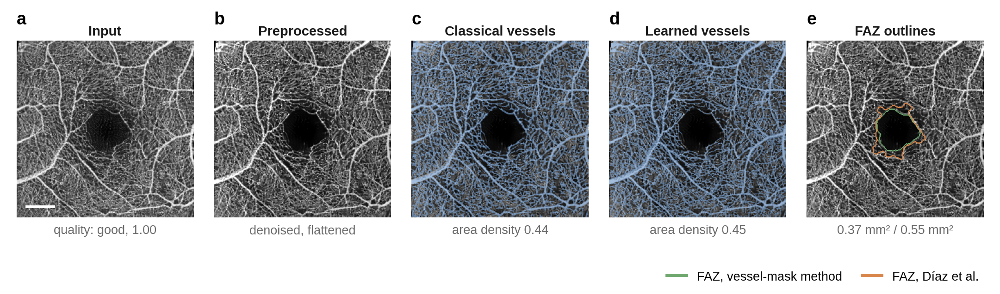
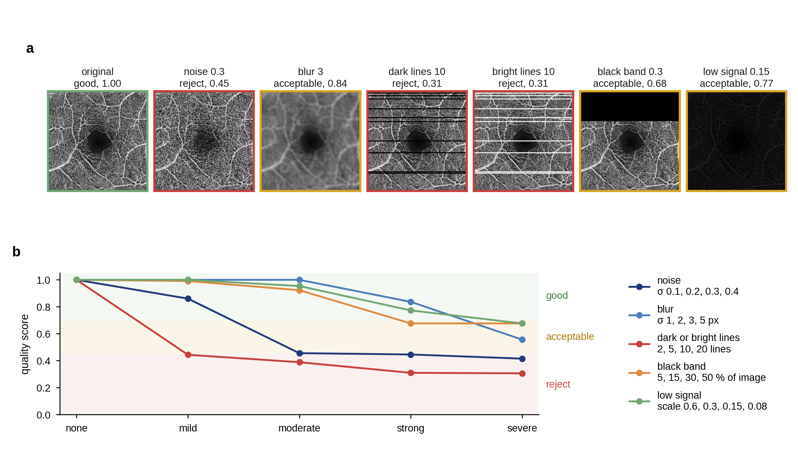

<h1 align="center">Awesome OCTA Tools</h1>

<p align="center">
  Quality control, preprocessing, FAZ and vessel segmentation, and biomarkers for en-face OCT angiography,<br>
  with the theory written down next to the code.
</p>

<p align="center">
  <a href="https://github.com/rdharini2001/Awesome_OCTA_Tools/actions/workflows/tests.yml"></a>
  
  <a href="LICENSE"></a>
  
</p>

<p align="center">
  
</p>

**Fig. 1 | One scan through the pipeline.** One simulated 3 × 3 mm scan from [Kreitner et al.](https://github.com/aiforvision/OCTA-autosegmentation). **a**, Input image with its quality grade and score (scale bar, 0.5 mm). **b**, After line repair, non-local-means denoising and background flattening. **c**, Classical vessel mask (Sato filter, hysteresis threshold) with its area density. **d**, Mask from the learned network. **e**, FAZ outlines from the vessel-mask method (green) and the method of Díaz et al. (orange), with their areas. Rebuild with `python scripts/make_figures.py pipeline`.

Most OCTA papers quietly repeat the same four steps: decide which images are usable, clean them up, find the vessels and the foveal avascular zone, then turn masks into numbers. Each step has literature behind it and each hides choices that move the result. This repository puts those steps in small, separate, tested modules, says where each choice comes from, and keeps a plain-language [primer](docs/octa_primer.md) next to them for anyone new to the modality.

It works on **single 2-D en-face slabs** (a superficial or deep image exported from the scanner). It does not read raw OCTA volumes or draw layer boundaries.

## What is in here

| Module | What it does | Read |
|---|---|---|
| `octatools.qc` | Scores an image and says why: line and motion artifacts, blink bands, noise, blur, contrast, saturation, optional projection check, optional device signal strength. Can fit its thresholds to your own grades. | [docs/qc.md](docs/qc.md) |
| `octatools.preprocessing` | Valid-pixel mask, line repair, denoising (six methods), background flattening, intensity stretch, CLAHE, cropping and resampling in millimetres, one logged recipe. | [docs/preprocessing.md](docs/preprocessing.md) |
| `octatools.faz` | Two FAZ detectors: a Python 3 port of [Díaz et al.](https://github.com/macarenadiaz/FAZ_Extraction) and a vessel-mask method. Area, perimeter, circularity, acircularity, axis ratio, axial-length scaling. | [docs/faz.md](docs/faz.md) |
| `octatools.vessels` | Classical ridge filters (Sato, Frangi, Meijering) with hysteresis, and the network of [Kreitner et al.](https://github.com/aiforvision/OCTA-autosegmentation) with tiling for larger fields. | [docs/vessel_segmentation.md](docs/vessel_segmentation.md) |
| `octatools.biomarkers` | Vessel area, skeleton and length density, mean width, fractal dimension, tortuosity, in ETDRS-style regions with and without the FAZ. | [docs/biomarkers.md](docs/biomarkers.md) |
| `octatools.simulate` | A phantom with known vessels and FAZ, and controlled degradations (noise, blur, lines, black bands, signal loss) for testing. | |
| [**OCTA primer**](docs/octa_primer.md) | What OCTA measures, SVC, DVC, ICP, DCP, the FAZ, artifacts, how vessel density is defined and why it depends on so much. | [docs/octa_primer.md](docs/octa_primer.md) |

<p align="center">
  
</p>

**Fig. 2 | Where the capillary plexuses sit.** Schematic, not to scale. The superficial vascular plexus (SVP, red) lies in the nerve fibre and ganglion cell layers and forms the superficial vascular complex (SVC). The intermediate (ICP, orange) and deep (DCP, purple) capillary plexuses at the inner nuclear layer borders together form the deep vascular complex (DVC). The dashed line marks where many devices split their two exported slabs; the exact boundary differs by device. NFL, nerve fibre layer; GCL, ganglion cell layer; IPL, inner plexiform layer; INL, inner nuclear layer; OPL, outer plexiform layer; ONL, outer nuclear layer; RPE, retinal pigment epithelium; CC, choriocapillaris. Details in the [primer](docs/octa_primer.md).

## Quick start

```bash
git clone https://github.com/rdharini2001/Awesome_OCTA_Tools.git
cd Awesome_OCTA_Tools
pip install -e .                 # core: numpy, scipy, scikit-image, opencv
pip install -e ".[deep]"         # optional: torch + monai for the learned vessel model
```

Run everything on the included example (a simulated scan):

```bash
python examples/quickstart.py
```

On your own scans, tell the tools how wide the scan is. Most functions need `fov_mm` so that filter sizes and regions are in real units.

```bash
octatools qc          scans/ --fov-mm 6 --csv qc.csv
octatools preprocess  scans/ --fov-mm 6 --preset vessel --out outputs/pre
octatools faz         scans/ --fov-mm 6 --method vessels --out outputs/faz
octatools vessels     scans/ --fov-mm 6 --method learned  --out outputs/vessels   # downloads weights once
octatools run         scans/ --fov-mm 6 --eye OD --out outputs/all                 # all steps, one CSV
```

The same from Python:

```python
from octatools import io
from octatools.qc import assess
from octatools.preprocessing import preprocess, preset
from octatools.vessels import segment_classical
from octatools.faz import faz_from_vessels, faz_metrics
from octatools.biomarkers import quantify

img = io.read_image("scan.png")                       # float32 in [0, 1], vessels bright
report = assess(img, fov_mm=6.0)                      # "good" / "acceptable" / "reject", with reasons
pre = preprocess(img, preset("vessel", fov_mm=6.0))   # pre.steps records what was applied
seg = segment_classical(pre.image, fov_mm=6.0)
faz = faz_from_vessels(seg.mask, fov_mm=6.0)
table = quantify(seg.mask, 6.0, faz=faz.mask, eye="OD")
table["parafovea_noFAZ"]["vessel_area_density"]
```

## Quality control

Poor scans produce confident, wrong numbers. The quality module is the part of this repository that was developed against real scans, because its first version was too forgiving: it scored the fraction of affected rows, and a single dark line with a misregistered strip below it touches only a percent of the rows while ruining the image. It now counts line events and detects abrupt row-to-row jumps.

<p align="center">
  
</p>

**Fig. 3 | Quality score under simulated degradation.** **a**, A simulated 3 × 3 mm scan and six degraded versions, with the grade and score returned by `assess` (frame colour: green good, amber acceptable, red reject). **b**, Score as each degradation increases from none to severe; shaded bands mark the grade ranges. Dark and bright lines give identical curves. Rebuild with `python scripts/make_figures.py qc`.

The cut-offs are starting points set from simulations and checked by eye, not validated against expert grades. [Fit them to your own graded images](docs/qc.md#these-cut-offs-are-starting-points) before using them for exclusion in a study.

## Things worth knowing before you trust a number

- **Treat automatic FAZ outlines as proposals.** The two detectors can differ noticeably even on a clean scan (0.37 and 0.55 mm² on the example in Fig. 1), and more on weak ones. Always look at the overlay. See [docs/faz.md](docs/faz.md).
- **The learned vessel model was trained on 3 × 3 mm scans.** Larger fields are tiled. The bundled example images are from its own simulated training domain and say nothing about accuracy on patients. See [docs/vessel_segmentation.md](docs/vessel_segmentation.md).
- **The classical vessel defaults** were picked on three simulated images. Check the overlay on your data.
- **Vessel density depends on the pipeline** (threshold, filtering, signal strength, slab definition, axial length). Compare numbers only between runs that share all of these.
- **Segmentation errors in the scanner's layers are invisible here.** That needs the volume.

## Checks that back the code

```bash
pip install -e ".[dev]"
pytest -m "not deep"                       # unit tests, a few seconds each
pytest -m deep                             # learned model; needs torch, monai and the weights
python scripts/make_figures.py             # rebuilds everything in assets/
python scripts/verify_against_upstream.py --upstream /path/to/OCTA-autosegmentation --images examples/data
```

The last script runs the authors' own `test.py` and the wrapper in this repository on the same images. On the three example images the masks agree exactly (Dice 1.0000 at the model's 1216 × 1216 resolution). The tests use a procedural phantom with known vessels and FAZ, so measured areas, densities, skeleton lengths and fractal dimensions are checked against exact answers.

## Layout

```
src/octatools/
  io.py               read and write images as float [0, 1]
  preprocessing/      geometry, stripes, denoise, background, contrast, projection, pipeline
  qc/                 metrics, scoring config, assessment, report, threshold calibration
  faz/                diaz.py (port), avascular.py (vessel-mask method), metrics.py
  vessels/            classical.py, threshold.py, synthetic.py (Kreitner et al.), weights.py
  biomarkers/         quantify.py, regions.py
  skeleton.py         skeleton length, branches, pruning
  evaluation.py       Dice, IoU, clDice
  simulate.py         phantom and degradations
  analyze.py          the chain in one call
  cli.py              the `octatools` command
tests/                unit tests and end-to-end checks
docs/                 primer and one page per module, plus references
examples/             quickstart and three simulated images
scripts/              figures and the upstream comparison
third_party/          licence of the vessel model's authors
```

## Credits

The FAZ detector is a port of the method and code of **Macarena Díaz, Jorge Novo, Pablo Cutrín, Francisco Gómez-Ulla, Manuel G. Penedo and Marcos Ortega** ([paper](https://doi.org/10.1371/journal.pone.0212364), [code](https://github.com/macarenadiaz/FAZ_Extraction)). The learned vessel segmenter is the work of **Linus Kreitner, Johannes C. Paetzold, Nikolaus Rauch, Chen Chen, Ahmed M. Hagag, Alaa E. Fayed, Sobha Sivaprasad, Sebastian Rausch, Julian Weichsel, Bjoern H. Menze, Matthias Harders, Benjamin Knier, Daniel Rueckert and Martin J. Menten** ([paper](https://doi.org/10.1109/TMI.2024.3354408), [code](https://github.com/aiforvision/OCTA-autosegmentation)). If you use those parts, please cite them. Full details, including licence status, are in [THIRD_PARTY.md](THIRD_PARTY.md), and every method used is in [docs/references.md](docs/references.md).

```bibtex
@article{diaz2019faz,
  title   = {Automatic segmentation of the foveal avascular zone in ophthalmological {OCT-A} images},
  author  = {D{\'i}az, Macarena and Novo, Jorge and Cutr{\'i}n, Pablo and G{\'o}mez-Ulla, Francisco and Penedo, Manuel G. and Ortega, Marcos},
  journal = {PLOS ONE}, volume = {14}, number = {2}, pages = {e0212364}, year = {2019},
  doi     = {10.1371/journal.pone.0212364}
}

@article{kreitner2024synthetic,
  title   = {Synthetic optical coherence tomography angiographs for detailed retinal vessel segmentation without human annotations},
  author  = {Kreitner, Linus and Paetzold, Johannes C. and Rauch, Nikolaus and Chen, Chen and Hagag, Ahmed M. and Fayed, Alaa E. and Sivaprasad, Sobha and Rausch, Sebastian and Weichsel, Julian and Menze, Bjoern H. and Harders, Matthias and Knier, Benjamin and Rueckert, Daniel and Menten, Martin J.},
  journal = {IEEE Transactions on Medical Imaging}, volume = {43}, number = {6}, pages = {2061--2073}, year = {2024},
  doi     = {10.1109/TMI.2024.3354408}
}
```

## Citing this repository

See [CITATION.cff](CITATION.cff). Code is MIT-licensed. Third-party code and data keep their own terms.

Maintained by Dharini Raghavan. Issues and pull requests are welcome, especially failure cases from devices and scan sizes that are not covered here.
