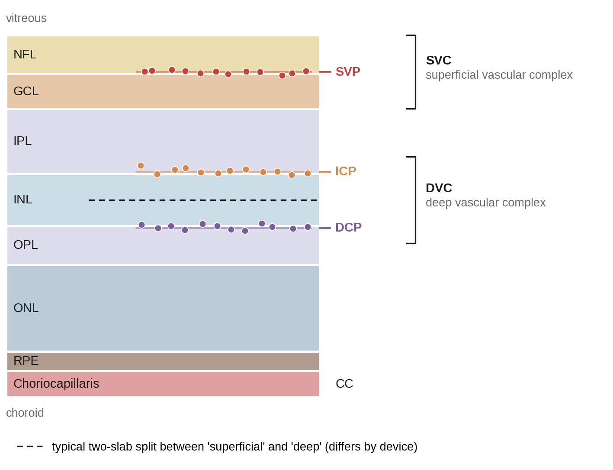

<h1 align="center">Awesome OCTA Tools</h1>

<p align="center">
  Quality control, preprocessing, FAZ and vessel segmentation, and biomarkers for en-face OCT angiography,<br>
  with practical examples and explanations of the methods behind each step.
</p>

<p align="center">
  <a href="https://github.com/rdharini2001/Awesome_OCTA_Tools/actions/workflows/tests.yml"></a>
  
  <a href="LICENSE"></a>
  
</p>

<p align="center">
  
</p>

**Fig. 1 | One scan through the pipeline.** One simulated 3 × 3 mm scan from [Kreitner et al.](https://github.com/aiforvision/OCTA-autosegmentation). **a**, Input image with its quality grade and score (scale bar, 0.5 mm). **b**, After line repair, non-local-means denoising and background flattening. **c**, Classical vessel mask (Sato filter, hysteresis threshold) with its area density. **d**, Mask from the learned network. **e**, FAZ outlines from the vessel-mask method (green) and the method of Díaz et al. (orange), with their areas. Rebuild with `python scripts/make_figures.py pipeline`.

An OCTA analysis usually starts with four tasks: checking image quality, preparing the image, identifying vessels and the foveal avascular zone (FAZ), and measuring their properties. Choices at each stage affect the final measurements. Awesome OCTA Tools brings these tasks together in a Python package, with separate modules that you can use independently or as a complete pipeline. Each guide explains the method, shows how to run it, and describes how to interpret its output. If you are new to OCTA, start with the [OCTA primer](docs/octa_primer.md).

It works on **single 2-D en-face slabs** (a superficial or deep image exported from the scanner). It does not read raw OCTA volumes or draw layer boundaries.

## Choose a module

| Module | What it does | Read |
|---|---|---|
| `octatools.qc` | Checks for artifacts and poor signal, then returns a quality score with reasons. You can compare its measurements with your own image grades to choose thresholds. | [docs/qc.md](docs/qc.md) |
| `octatools.preprocessing` | Prepares images through line repair, denoising, background correction, and contrast adjustment. It also supports cropping and resampling in physical units and records the steps applied. | [docs/preprocessing.md](docs/preprocessing.md) |
| `octatools.faz` | Estimates the FAZ from the image or a vessel mask and measures its area and shape. The image-based detector is a Python 3 port of the method by [Díaz et al.](https://github.com/macarenadiaz/FAZ_Extraction). | [docs/faz.md](docs/faz.md) |
| `octatools.vessels` | Segments vessels using classical ridge filters or the pretrained network by [Kreitner et al.](https://github.com/aiforvision/OCTA-autosegmentation). The network processes larger fields as smaller tiles. | [docs/vessel_segmentation.md](docs/vessel_segmentation.md) |
| `octatools.biomarkers` | Measures vessel density, width, and network structure within regions based on the ETDRS grid. It can also exclude the FAZ from each region. | [docs/biomarkers.md](docs/biomarkers.md) |
| `octatools.simulate` | Generates a test image with known vessel and FAZ masks, then adds controlled artifacts to help you check the analysis. | [docs/simulation.md](docs/simulation.md) |
| [**OCTA primer**](docs/octa_primer.md) | Explains what OCTA measures, how retinal layers are represented, and why artifacts and analysis choices affect vessel measurements. | [docs/octa_primer.md](docs/octa_primer.md) |

<p align="center">
  
</p>

**Fig. 2 | Where the capillary plexuses sit.** Schematic, not to scale. The superficial vascular plexus (SVP, red) lies in the nerve fibre and ganglion cell layers and forms the superficial vascular complex (SVC). The intermediate (ICP, orange) and deep (DCP, purple) capillary plexuses at the inner nuclear layer borders together form the deep vascular complex (DVC). The dashed line marks where many devices split their two exported slabs; the exact boundary differs by device. NFL, nerve fibre layer; GCL, ganglion cell layer; IPL, inner plexiform layer; INL, inner nuclear layer; OPL, outer plexiform layer; ONL, outer nuclear layer; RPE, retinal pigment epithelium; CC, choriocapillaris. Details in the [primer](docs/octa_primer.md).

## Install and run your first analysis

Use Python 3.10 or later. Run these commands in a terminal to clone the repository and install the package in a virtual environment:

```bash
git clone https://github.com/rdharini2001/Awesome_OCTA_Tools.git
cd Awesome_OCTA_Tools
python -m venv .venv
source .venv/bin/activate
python -m pip install -e .
```

On Windows, activate the environment with `.venv\Scripts\activate` instead. Keep the environment active when running the commands below.

The core installation includes everything needed for the classical analysis. Try it on an included simulated scan:

```bash
python examples/quickstart.py
```

The example prints the quality grade, FAZ measurements when a FAZ is found, and vessel measurements for several regions. It uses classical vessel segmentation and does not download model weights. To save a results table and images that you can inspect, run:

```bash
octatools run examples/data/synthetic_20230216_232653.png --fov-mm 3 --eye OD --out outputs/example
```

Open `outputs/example/results.csv` for the measurements and `outputs/example/synthetic_20230216_232653_summary.png` for a panel showing the original image, the preprocessed image, and the segmentation overlay. Check the overlay before interpreting the numbers. The sample is simulated and demonstrates how the software works; it does not establish accuracy on patient scans.

### Prepare your own images

Use a single 2-D en-face slab exported as PNG, TIFF, JPEG, or BMP, with bright vessels on a dark background. Remove labels, colour bars, and scanner interface elements before analysis. `io.read_image` converts the file to a grayscale floating-point array in the range [0, 1].

Set `--fov-mm` to the physical width of the image you supply. For a square 6 × 6 mm export, use `--fov-mm 6`; for the bundled 3 × 3 mm examples, use `--fov-mm 3`. The tools assume equal pixel spacing in both directions. If you crop an image outside the package, update the field of view to match the crop.

Each image command accepts either one image file or a folder. Folder processing reads supported images directly inside that folder and does not search subfolders. Keep source scans separate from masks and generated outputs so they are not analysed as new scans.

### Run individual steps

These examples assume `scans/` contains 6 × 6 mm images. Each command starts from those source images; you do not need to run the preceding command first.

```bash
octatools qc scans/ --fov-mm 6 --csv outputs/qc.csv
octatools preprocess scans/ --fov-mm 6 --preset vessel --out outputs/pre
octatools vessels scans/ --fov-mm 6 --method classical --preprocess --out outputs/vessels
octatools faz scans/ --fov-mm 6 --method vessels --out outputs/faz
octatools run scans/ --fov-mm 6 --eye OD --skip-rejected --out outputs/all
```

The `vessels` command preprocesses its input only when you add `--preprocess`. The `faz` and `run` commands apply their own preprocessing. The full pipeline records QC for every image and continues with rejected images unless you add `--skip-rejected`. Use `OD` for a right eye and `OS` for a left eye, and process the two eyes separately when setting this option for a folder.

There is no separate biomarkers command. `octatools run` writes whole-image and FAZ-excluded parafoveal measurements to `results.csv`; the Python API provides the full set of regions. For details on saved files and options, see the [running guide](docs/running.md), or use `octatools <command> --help`.

### Use the Python API

Run this from the repository root, or replace the example path with your own scan and set its field of view:

```python
from octatools import io
from octatools.analyze import analyze

img = io.read_image("examples/data/synthetic_20230216_232653.png")
result = analyze(img, fov_mm=3.0, eye="OD")

print(result.qc.grade, result.qc.flags)
print(result.biomarkers["whole"]["vessel_area_density"])
if result.faz is not None:
    print("FAZ area (mm²):", result.faz_stats["area_mm2"])
else:
    print(result.notes)
```

The module guides show how to call each stage separately and adjust its settings.

### Add the learned vessel model

Install the optional dependencies and download the pretrained weights before running inference:

```bash
python -m pip install -e ".[deep]"
octatools weights
octatools vessels scans/ --fov-mm 6 --method learned --out outputs/learned
```

The first download requires internet access. Inference uses the CPU by default; use `--device cuda` if your PyTorch installation supports an available CUDA GPU. See the [vessel segmentation guide](docs/vessel_segmentation.md) for training-domain limits, tiling, and weight-cache settings.

## Quality control

Image quality affects every later measurement. A dim scan can lose visible capillaries, while motion can break or displace vessels. The quality module checks for these problems and returns a score, a grade, and the reasons behind the grade. It counts separate line artifacts and detects abrupt changes between neighbouring rows, because even a small affected part of an image can disrupt its vessel network.

<p align="center">
  
</p>

**Fig. 3 | Quality score under simulated degradation.** **a**, A simulated 3 × 3 mm scan and six degraded versions, with the grade and score returned by `assess` (frame colour: green good, amber acceptable, red reject). **b**, Score as each degradation increases from none to severe; shaded bands mark the grade ranges. Dark and bright lines give identical curves. Rebuild with `python scripts/make_figures.py qc`.

The cut-offs are starting points set from simulations and checked by eye, not validated against expert grades. [Fit them to your own graded images](docs/qc.md#these-cut-offs-are-starting-points) before using them for exclusion in a study.

## Interpret the results

- **Treat automatic FAZ outlines as proposals.** The two detectors can differ noticeably even on a clean scan (0.37 and 0.55 mm² on the example in Fig. 1), and more on weak ones. Always look at the overlay. See [docs/faz.md](docs/faz.md).
- **The learned vessel model was trained on 3 × 3 mm scans.** Larger fields are tiled. The bundled example images are from its own simulated training domain and say nothing about accuracy on patients. See [docs/vessel_segmentation.md](docs/vessel_segmentation.md).
- **The classical vessel defaults were selected using three simulated images.** Inspect their results on your own scans before choosing the settings for an analysis.
- **Vessel density depends on the pipeline** (threshold, filtering, signal strength, slab definition, axial length). Compare numbers only between runs that share all of these.
- **Layer-boundary errors require review of the OCT volume.** An exported en-face image cannot show whether the scanner placed those boundaries correctly.

## Check your installation and reproduce the figures

```bash
pip install -e ".[dev]"
pytest -m "not deep and not network"       # core tests without model downloads
pytest -m deep                             # learned model; needs torch, monai and the weights
python scripts/make_figures.py             # rebuilds everything in assets/
python scripts/verify_against_upstream.py --upstream /path/to/OCTA-autosegmentation --images examples/data
```

The last script runs the authors' own `test.py` and the wrapper in this repository on the same images. On the three example images the masks agree exactly (Dice 1.0000 at the model's 1216 × 1216 resolution). The tests also use procedural images and simple shapes with known properties to check areas, densities, skeleton lengths, and fractal dimensions. These checks test implementation behavior; they do not establish performance on clinical images.

## Layout

```
src/octatools/
  io.py               read and write images as float [0, 1]
  preprocessing/      geometry, stripes, denoise, background, contrast, projection, pipeline
  qc/                 metrics, scoring config, assessment, report, threshold calibration
  faz/                diaz.py (port), avascular.py (vessel-mask method), metrics.py
  vessels/            classical.py, threshold.py, synthetic.py (Kreitner et al.), weights.py
  biomarkers/         quantify.py, regions.py
  skeleton.py         skeleton length, branches, pruning
  evaluation.py       Dice, IoU, clDice
  simulate.py         phantom and degradations
  analyze.py          the chain in one call
  cli.py              the `octatools` command
tests/                unit tests and end-to-end checks
docs/                 primer and one page per module, plus references
examples/             quickstart and three simulated images
scripts/              figures and the upstream comparison
third_party/          licence of the vessel model's authors
```

## Credits

The FAZ detector is a port of the method and code of **Macarena Díaz, Jorge Novo, Pablo Cutrín, Francisco Gómez-Ulla, Manuel G. Penedo and Marcos Ortega** ([paper](https://doi.org/10.1371/journal.pone.0212364), [code](https://github.com/macarenadiaz/FAZ_Extraction)). The learned vessel segmenter is the work of **Linus Kreitner, Johannes C. Paetzold, Nikolaus Rauch, Chen Chen, Ahmed M. Hagag, Alaa E. Fayed, Sobha Sivaprasad, Sebastian Rausch, Julian Weichsel, Bjoern H. Menze, Matthias Harders, Benjamin Knier, Daniel Rueckert and Martin J. Menten** ([paper](https://doi.org/10.1109/TMI.2024.3354408), [code](https://github.com/aiforvision/OCTA-autosegmentation)). If you use those parts, please cite them. Full details, including licence status, are in [THIRD_PARTY.md](THIRD_PARTY.md), and every method used is in [docs/references.md](docs/references.md).

```bibtex
@article{diaz2019faz,
  title   = {Automatic segmentation of the foveal avascular zone in ophthalmological {OCT-A} images},
  author  = {D{\'i}az, Macarena and Novo, Jorge and Cutr{\'i}n, Pablo and G{\'o}mez-Ulla, Francisco and Penedo, Manuel G. and Ortega, Marcos},
  journal = {PLOS ONE}, volume = {14}, number = {2}, pages = {e0212364}, year = {2019},
  doi     = {10.1371/journal.pone.0212364}
}

@article{kreitner2024synthetic,
  title   = {Synthetic optical coherence tomography angiographs for detailed retinal vessel segmentation without human annotations},
  author  = {Kreitner, Linus and Paetzold, Johannes C. and Rauch, Nikolaus and Chen, Chen and Hagag, Ahmed M. and Fayed, Alaa E. and Sivaprasad, Sobha and Rausch, Sebastian and Weichsel, Julian and Menze, Bjoern H. and Harders, Matthias and Knier, Benjamin and Rueckert, Daniel and Menten, Martin J.},
  journal = {IEEE Transactions on Medical Imaging}, volume = {43}, number = {6}, pages = {2061--2073}, year = {2024},
  doi     = {10.1109/TMI.2024.3354408}
}
```

## Citing this repository

See [CITATION.cff](CITATION.cff). Code is MIT-licensed. Third-party code and data keep their own terms.

Maintained by Dharini Raghavan. Issues and pull requests are welcome, especially failure cases from devices and scan sizes that are not covered here.
