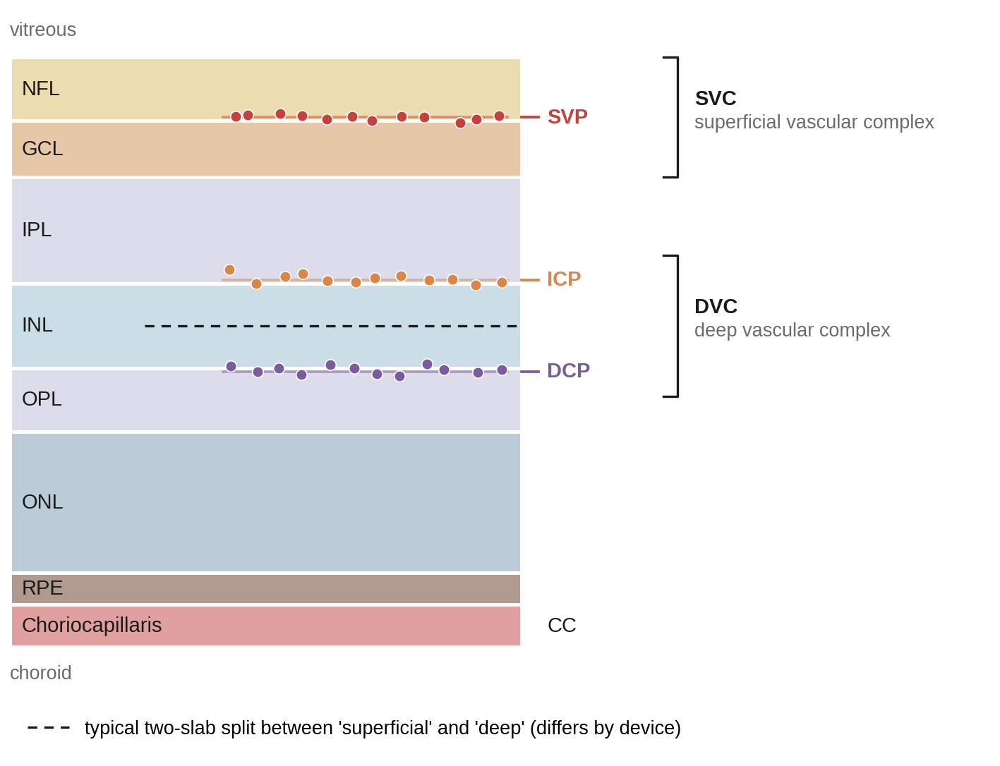

# OCTA in one sitting

This is the background you need to use the tools in this repository without misreading their output. It is a working summary, not a review. The reviews it leans on are Spaide et al. 2018, Kashani et al. 2017 and Hormel et al. 2021; full references are in [references.md](references.md).

## What OCTA measures

Optical coherence tomography (OCT) records how much near-infrared light is scattered back from each depth in the tissue. Optical coherence tomography angiography (OCTA) adds one trick: it scans the same spot several times in quick succession and looks at what changed.

Static tissue returns almost the same signal every time. Inside a vessel, red blood cells move between repeats, so the backscattered signal fluctuates. The amount of change is the **flow signal**, and no dye is needed (de Carlo et al. 2015, Chen and Wang 2017).

How "change" is computed depends on the method:

| Family | Uses | Examples |
|---|---|---|
| Intensity-based | amplitude of the OCT signal | speckle variance, correlation mapping, SSADA |
| Phase-based | phase of the OCT signal | phase variance, Doppler variance |
| Complex | amplitude and phase together | OMAG |

**SSADA** (split-spectrum amplitude-decorrelation angiography, Jia et al. 2012) deserves a note because many images in public datasets come from it. It splits the spectrum into narrower bands, computes amplitude decorrelation in each, and averages. This trades some axial resolution for a better flow signal-to-noise ratio and less sensitivity to axial bulk motion.

Two consequences matter for everything downstream:

- **OCTA shows where flow is detectable, not how fast it is.** The time between repeated scans sets the slowest flow that can be seen, and fast flow saturates. A vessel with very slow flow can be missing; a bright vessel is not necessarily a high-flow vessel (Spaide et al. 2018, Ploner et al. 2016).
- **Dark does not mean "no vessel".** It can also mean flow below the detection floor, a shadow from something above, or weak signal.

## From a 3-D volume to the picture you are given

Each scan is a volume of flow signal. To look at it, the volume is cut into **slabs** between two segmentation surfaces (for example the inner limiting membrane and the inner plexiform layer) and each slab is collapsed to a 2-D **en-face** image, usually by a maximum or mean projection along depth.

Two things follow:

1. The picture depends on where the surfaces were drawn. A segmentation error moves vessels from one slab to another, or lets another layer leak in.
2. Instruments with the same slab name do not use the same boundaries. Spaide and Curcio (2017) compared "superficial" and "deep" layers across devices and found clear differences. Never compare vessel measures across devices without a reason to believe the slabs are equivalent.

Every function in this repository works on a single 2-D en-face image. Anything that needs the volume (true projection removal, B-scan segmentation checks, flow cube quality) is outside what this package can do. Where that limits an answer, the docs say so.

## The retinal capillary layers

Within the macula the retinal capillaries are organised in plexuses at different depths. The anatomy below follows Campbell et al. 2017 and Hormel et al. 2021.



*Schematic, not to scale. Dashed line: where many devices split their two exported slabs.*

| Term | Meaning | Where it sits |
|---|---|---|
| **SVP** or **SCP** | superficial vascular (capillary) plexus | nerve fibre layer and ganglion cell layer |
| **ICP** | intermediate capillary plexus | around the inner border of the inner nuclear layer |
| **DCP** | deep capillary plexus | around the outer border of the inner nuclear layer |
| **SVC** | superficial vascular complex | the SVP, often with the larger vessels that feed it |
| **DVC** | deep vascular complex | the ICP and DCP together |
| **RPC** | radial peripapillary capillaries | nerve fibre layer around the optic disc |
| **CC** | choriocapillaris | just below Bruch's membrane, outside the retina |

The picture is simplest in the "two-slab" world most commercial instruments still export:

- a **superficial** image, which is mostly the SVP/SVC, and
- a **deep** image, which is meant to be the ICP and DCP (the DVC) but whose exact boundaries depend on the vendor.

Research systems that segment three plexuses separately (Campbell et al. 2017, Garrity et al. 2017) show that the deep complex really is two layers with different patterns. When a paper says "SVC and DVC" it usually means these two slabs. When it says "SCP and DCP" it usually means the same thing with older vocabulary.

Retinal layer abbreviations used above and in the docs: ILM internal limiting membrane, NFL nerve fibre layer, GCL ganglion cell layer, IPL inner plexiform layer, INL inner nuclear layer, OPL outer plexiform layer, ONL outer nuclear layer, RPE retinal pigment epithelium.

## The foveal avascular zone

The **FAZ** is the capillary-free region at the centre of the fovea. It is the most commonly reported OCTA shape measure: area, perimeter and how far from circular it is.

Things worth knowing before you compare numbers:

- Healthy values vary widely between people and between devices; many reports of the superficial-slab area fall roughly between 0.2 and 0.4 mm², but check the source for the slab, device and method (Shahlaee et al. 2016, Magrath et al. 2017).
- The outline differs between slabs. Always say which slab you measured.
- The measured area depends on the eye. Lateral scale follows the axial length, so an eye that is longer than the device's model eye is scanned over a larger true width than the image claims. Linderman et al. 2017 and Sampson et al. 2017 quantify this. [`scale_area_by_axial_length`](../src/octatools/faz/metrics.py) applies the Bennett et al. 1994 correction.
- The shape depends on the segmentation method as much as on the eye. Treat an automatic outline as a proposal and look at it.

See [faz.md](faz.md).

## Scan size and pixel size

Pixel size follows from field of view and sampling:

```
pixel size (µm) = field of view (mm) × 1000 / pixels across
```

For example a 3 × 3 mm scan sampled at 304 pixels is 9.9 µm per pixel and a 6 × 6 mm scan at 400 pixels is 15 µm per pixel (those are the sizes in the OCTA-500 dataset, Li et al. 2020). The lateral optical resolution of most systems is coarser than the sampling, so adjacent pixels are not independent.

This is why most functions here take `fov_mm`: filter scales, minimum object sizes and region radii are written in micrometres or millimetres and converted, so the same call works on a 3 mm and a 6 mm image.

## What goes wrong

The classic reference is Spaide, Fujimoto and Waheed (2015), with later work on swept-source instruments (Ghasemi Falavarjani et al. 2017) and on how often each artifact occurs (Lauermann et al. 2018).

| Artifact | What you see in the en-face image | Cause |
|---|---|---|
| Motion lines | thin bright or dark horizontal lines, doubled or broken vessels | eye or head movement during the fast scan |
| Blink or dropout | wide black band | loss of signal while the eye closes |
| Low signal | dim, grainy image, capillaries missing | media opacity, poor focus, small pupil, weak OCT signal |
| Shadowing | dark patch with a vessel-shaped edge | something above attenuates the beam (floater, vessel, hyper-reflective lesion) |
| Projection | deep slab copies superficial vessels | flow signal from superficial vessels projects onto layers below |
| Segmentation error | vessels from the wrong layer, or a mix of layers | slab boundaries misplaced (common with oedema, atrophy, high myopia) |
| Defocus or blur | softened vessels | focus off, or tracking filtered out detail |
| Decorrelation tail | tails or trailing signal below a vessel | same mechanism as projection |

[`octatools.qc`](qc.md) measures the first three directly from the image. It can check for projection if you give it both slabs. It cannot see segmentation errors without the volume.

## Reporting vessel measures

Three families of metrics are common, and papers use confusing names for them:

| Idea | Typical names | How it is computed |
|---|---|---|
| Fraction of area occupied by vessels | vessel density (Optovue), perfusion density (Zeiss), vessel area density | binarise, count vessel pixels over region pixels |
| Total vessel length per area | vessel length density, "vessel density" in Zeiss output | skeletonise, sum skeleton length, divide by area |
| Average vessel calibre | vessel diameter index | vessel area over skeleton length |

Chu et al. 2016 name the first two VAD and VSD. Rabiolo et al. 2018 compare quantification methods on the same scans and show the numbers move with the method.

Cautions that apply to every one of these:

- **The threshold is part of the measurement.** Binarisation method, brightness and contrast changes all change the result (Mehta et al. 2019). Fix the pipeline and report it.
- **Signal strength changes vessel density.** Lower signal means fewer visible capillaries and a lower number, in healthy eyes too (Lim et al. 2018, Yu et al. 2019). Compare images only above a quality floor.
- **Region matters.** Whole-image density includes the FAZ and its edge. Many studies report a parafoveal ring and, separately, the FAZ.
- **Axial length matters** for any measure that is a length or an area (see above).

See [biomarkers.md](biomarkers.md) for the exact definitions used here.

## Glossary

| Short | Long |
|---|---|
| AL | axial length |
| CC | choriocapillaris |
| DCP | deep capillary plexus |
| DVC | deep vascular complex (ICP + DCP) |
| ETDRS grid | concentric 1, 3 and 6 mm circles centred on the fovea |
| FAZ | foveal avascular zone |
| FOV | field of view |
| ICP | intermediate capillary plexus |
| OCT | optical coherence tomography |
| OCTA | optical coherence tomography angiography |
| OMAG | optical microangiography |
| PD | perfusion density |
| PR-OCTA | projection-resolved OCTA |
| RPC | radial peripapillary capillaries |
| SCP, SVP | superficial capillary / vascular plexus |
| SSADA | split-spectrum amplitude-decorrelation angiography |
| SSI | signal strength index (Optovue's quality number) |
| SVC | superficial vascular complex |
| VAD | vessel area density |
| VD | vessel density |
| VLD | vessel length density |
| VSD | vessel skeleton density |

## Where to read more

- Spaide, Fujimoto, Waheed, Sadda, Staurenghi. *Optical coherence tomography angiography.* Prog Retin Eye Res 2018. The best single overview.
- Kashani et al. *Optical coherence tomography angiography: a comprehensive review of current methods and clinical applications.* Prog Retin Eye Res 2017.
- Hormel et al. *Plexus-specific retinal vascular anatomy and pathologies as seen by projection-resolved optical coherence tomographic angiography.* Prog Retin Eye Res 2021.
- Spaide, Fujimoto, Waheed. *Image artifacts in optical coherence tomography angiography.* Retina 2015.
