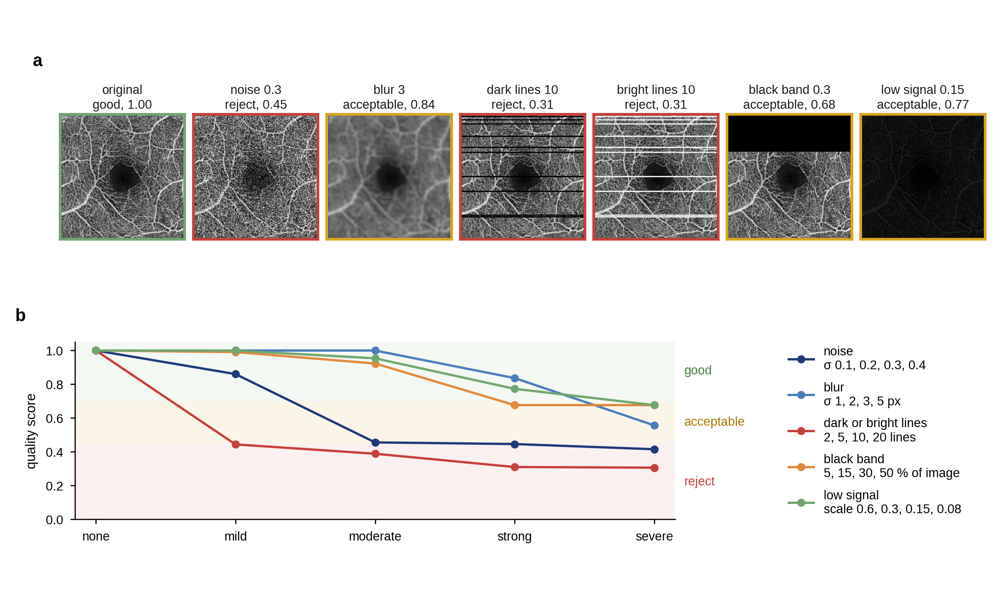

# Quality control

Image artifacts can change a measurement even when the analysis completes successfully. Dim scans can lose visible capillaries and appear to have low vessel density, motion lines can interrupt vessels, and a blink can leave a black band. Several studies show that vessel density falls with signal strength even in healthy eyes (Lim et al. 2018, Yu et al. 2019), and that artifacts are common, vary by disease and by device, and are often missed by simple signal-strength cut-offs (Spaide et al. 2015, Lauermann et al. 2018, Fenner et al. 2018). Start by reviewing image quality so you can distinguish acquisition problems from changes in the measured vessel network.

```python
from octatools import io
from octatools.qc import assess

report = assess(io.read_image("examples/data/synthetic_20230216_232653.png"), fov_mm=3.0)
report.grade      # "good", "acceptable" or "reject"
report.score      # 0..1
report.flags      # human-readable reasons
report.metrics    # every number behind the grade
```

Run this command on the bundled example from the repository root:

```bash
octatools qc examples/data/synthetic_20230216_232653.png --fov-mm 3 --csv outputs/qc.csv
```

The terminal shows the grade, score, and any flags. The CSV stores the measurements for later review. Replace the input with `scans/` and use `--fov-mm 6` for a folder of 6 × 6 mm scans. QC reports image quality; it does not remove files or prevent you from running another module.



**Quality score under simulated degradation.** **a**, A simulated scan and six degraded versions with the grade and score from `assess`. **b**, Score against degradation strength; shaded bands mark the grade ranges.

## What it measures

All measures come from the en-face image alone. They are computed on the valid pixels only (black borders left by registration are excluded) and, when `fov_mm` is given, at a common pixel size of about 10 µm. Resampling only ever goes down: interpolating a coarse image up would smooth its noise and make it look cleaner than it is.

| measure | what it is | what raises the alarm |
|---|---|---|
| `coverage` | share of the image that carries data | blink bands, registration loss at the border |
| `line_events` | number of separate line artifacts: rows that are far darker or brighter than their neighbours, plus abrupt jumps between neighbouring rows | motion, blinks, strip misalignment (Spaide et al. 2015) |
| `motion_fraction` | share of rows flagged as lines | the same, weighted by how much of the image is affected |
| `signal_fraction` | 1 − (noise variance) / (image variance) | grainy, low-signal images |
| `noise_sigma` | noise standard deviation, Immerkaer's estimate made robust with a median (Immerkaer 1996) | reported, not scored on its own |
| `blur` | no-reference blur score, 0 sharp to 1 blurred (Crete et al. 2007) | defocus, over-smoothing |
| `contrast` | 95th minus 5th percentile of intensity | dim, flat images |
| `clipped_fraction` | share of pixels at the top of the intensity range | saturation, pre-binarised exports |
| `peripheral_dark` | share of the periphery much darker than typical | shadows, opacities and non-perfusion alike |
| `vessel_density` | area density from a quick classical segmentation | values outside a plausible band mean something is off |
| `projection_corr` | correlation between the deep and superficial slabs, if you pass both | deep slab is mostly a copy of the superficial one (Zhang et al. 2016) |
| `signal_strength` | the device's own index, if you pass it | below a minimum you set |

The line checks address two different problems:

- **Count lines, not row fractions.** On real scans a single dark line with a misregistered strip below it can ruin an image while touching only 1 % of the rows. The first version of this module scored the fraction and rated such images as good. It now counts events. With the default anchors, two or more events give the line-event sub-score its lowest value; more than three events also trigger an explicit hard-fail rule.
- **Misaligned strips can cause jumps without a visible line.** Registration joins strips of the scan together. When a strip is misplaced there may be no dark row at all, only vessels that shift across a seam. `detect_jumps` looks at the difference between neighbouring rows after a light blur; it spikes at a seam and is flat elsewhere.

## From measures to a grade

Each measure becomes a sub-score from 0 to 1 by a linear ramp between a "bad" and a "good" anchor (see `QCConfig.anchors`). The overall `score` is the weighted geometric mean of the sub-scores, which makes it sensitive to a low score in any one measure. The default grading rules are:

- **reject** if any hard-fail rule fires (coverage below 0.60, more than three line events, more than 15 % flagged rows, signal fraction below 0.25, or a device signal strength below your minimum) or the score is below 0.45;
- **good** if the score is at least 0.70 and no single measure is poor (sub-score under 0.34);
- **acceptable** otherwise.

`report.flags` explains which measurements contributed to a poor result. A grade describes the checks performed here, so review it alongside the image and any scanner-provided quality information.

### These cut-offs are starting points

The anchors were set from simulated degradations of one image (the figure above) and then checked by eye on 80 randomly chosen real 6 × 6 mm en-face images from a public dataset (AI-READI; no images are redistributed here). On those 80, 36 had no line events, 28 had one, and 16 had two or more; the images that scored lowest were visibly the worst, with broken and displaced strips. This visual review helped identify obvious failures, but the score has not been validated against independent expert grades for those images.

To evaluate the thresholds for your dataset, first label each image as usable (`1`) or unusable (`0`) in a new `usable` column in the QC CSV. Include both classes, then run:

```bash
octatools qc images/ --fov-mm 6 --csv qc.csv        # then add a 0/1 `usable` column by hand
octatools fit-qc qc.csv --label-column usable
```

`fit-qc` prints, for every measure, the AUC separating usable from unusable images and the cut-off that maximises Youden's J. It reports candidate thresholds; it does not save a configuration or change future QC runs. Review the results, update `QCConfig` through the Python API, and evaluate the resulting rule on held-out graded images. `octatools.qc.calibrate` has the functions if you want to build your own rule. Apply the same QC rule to every group in a study, and report how many images were excluded and why.

## Device-reported signal strength

Every vendor exports some quality number. Use it as well; this module does not replace it. Pass it in and set a floor:

```python
from octatools.qc import QCConfig, assess
img = io.read_image("scan.png")  # Replace this with your 6 × 6 mm export.
report = assess(img, 6.0, signal_strength=7, config=QCConfig(min_signal_strength=6))
```

Thresholds in the literature differ by device and study design. Many papers require at least 6 out of 10 on the Zeiss quality index and about 55 to 60 on the Optovue signal strength index; check the manual and the studies closest to yours (Lim et al. 2018 is a good start). The two are not interchangeable, and a good number does not rule out motion or segmentation artifacts, which is why image-based checks help.

## Limits of an en-face quality check

- **Segmentation errors.** Boundaries drawn in the wrong place are visible only in the B-scans. An image can pass every check here and still show the wrong layer, especially in oedema, atrophy and high myopia (Spaide and Curcio 2017, Lauermann et al. 2018).
- **Real shadows versus real non-perfusion.** `peripheral_dark` flags dark areas. Without the volume the two cannot be told apart.
- **Noise in images that were interpolated.** An image that was upsampled from a coarser scan has smooth noise, so `signal_fraction` stays high. This is a property of the file, not the eye.
- **Vertical lines.** By default only horizontal lines (a horizontal fast axis) are checked. If your export is rotated, pass `QCConfig(stripe_axes=(1,))` or `(0, 1)`.
- **Small alignment errors may be missed.** A strip can be displaced without producing enough intensity change for the jump detector to flag it.
- **The grade describes image quality.** A "good" result means the image passed the checks performed by this module; it does not describe the health of the eye.

## Deep-learning alternatives

Lauermann et al. 2019 trained a network to grade OCTA quality directly. If you have enough graded data, such a model may recognise image problems that individual measurements miss. The measures provided here require no training data and expose the values behind each grade. Their CSV output can also help you organise a dataset for manual labelling.
